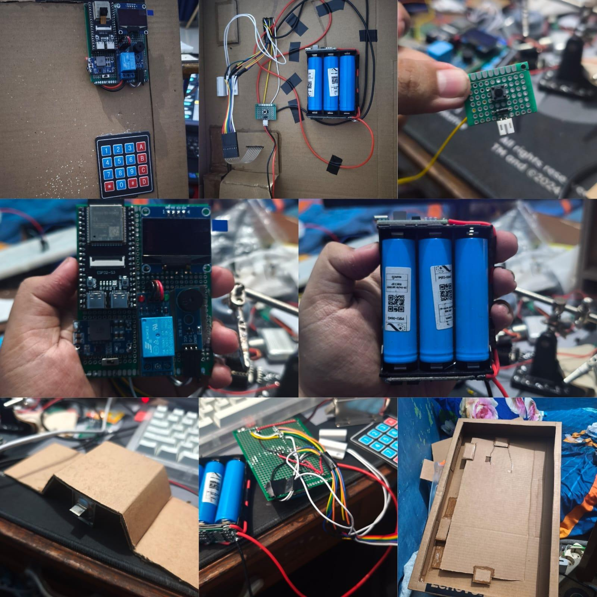
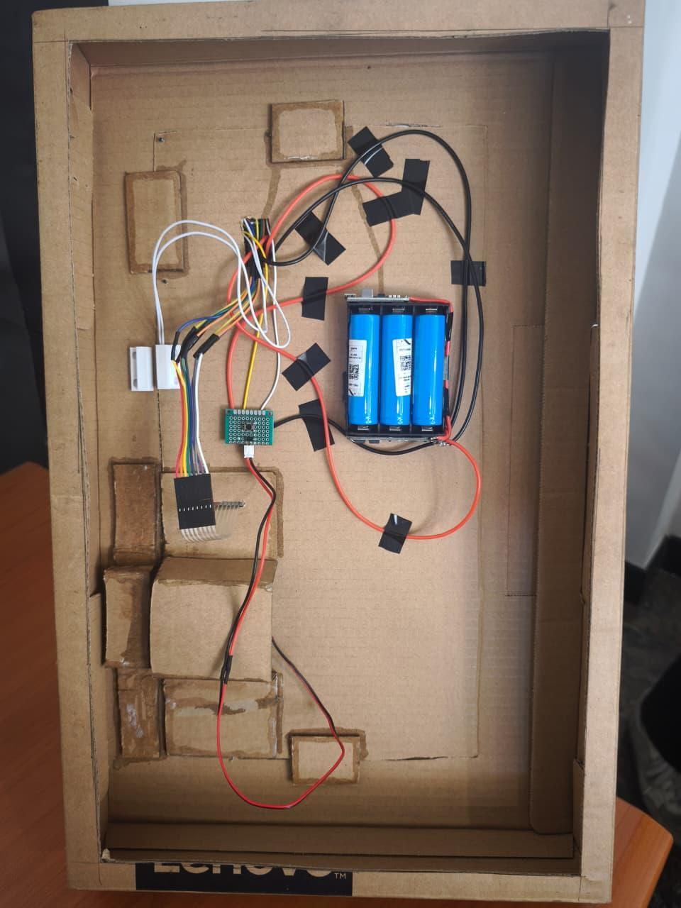
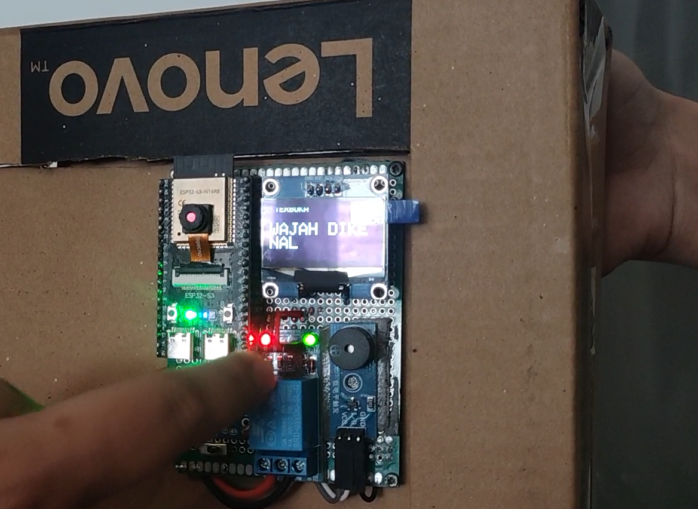
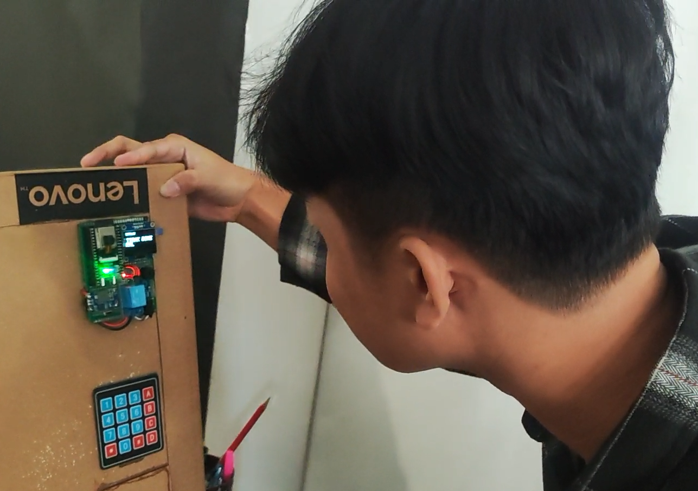
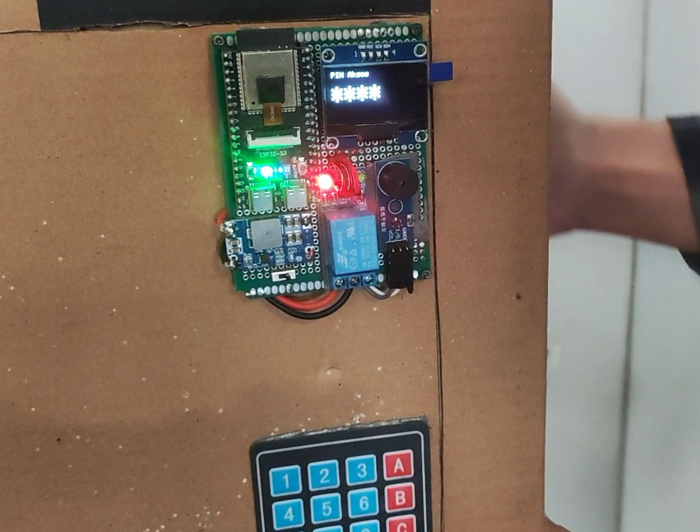
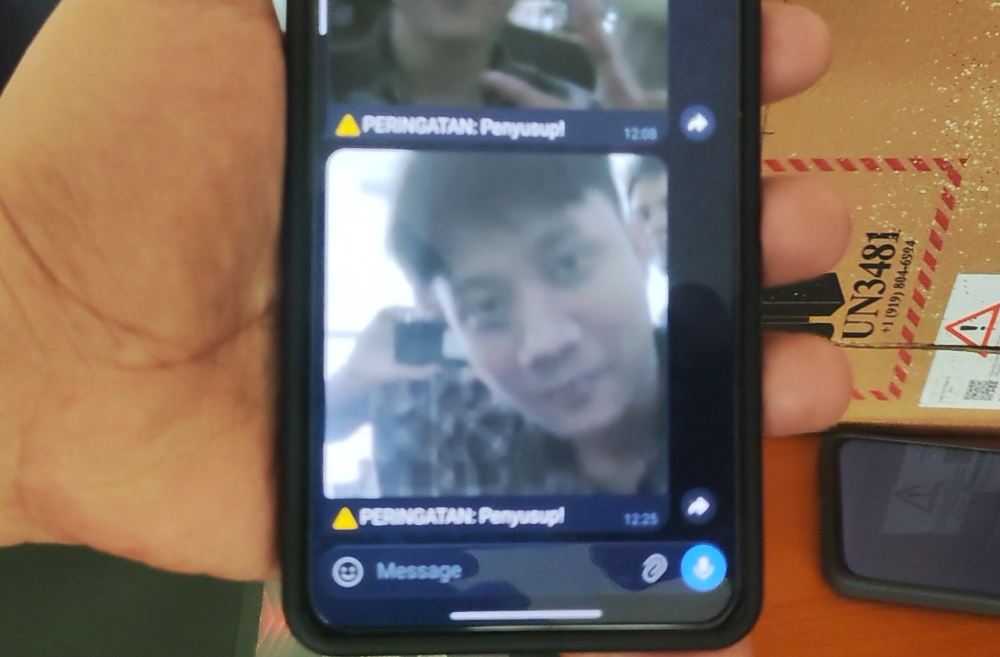
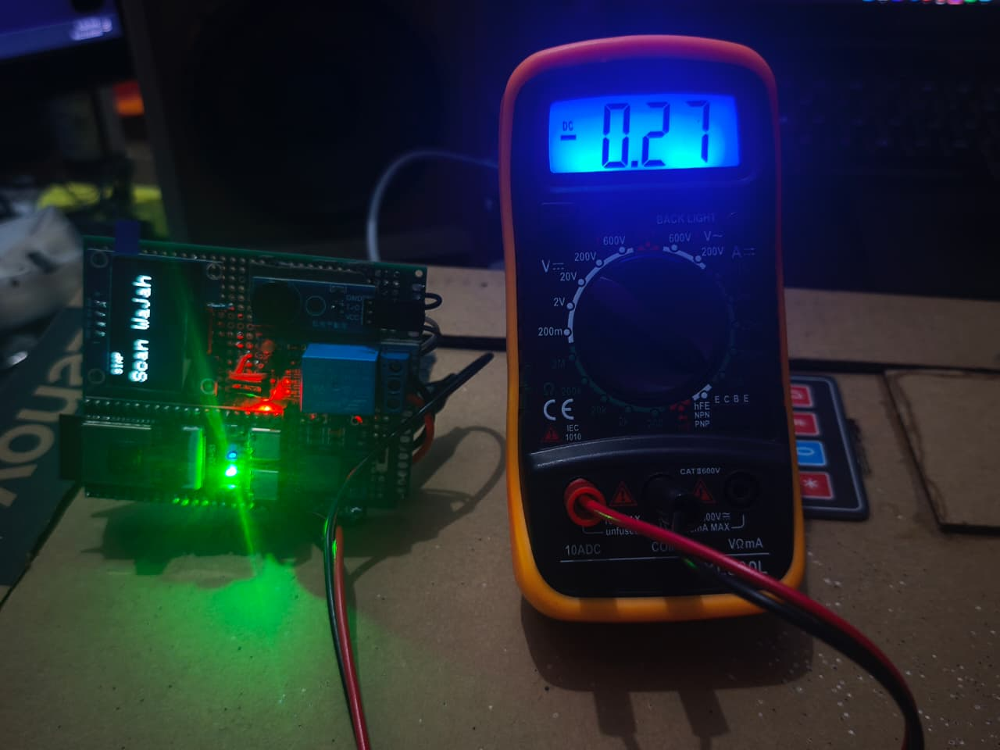
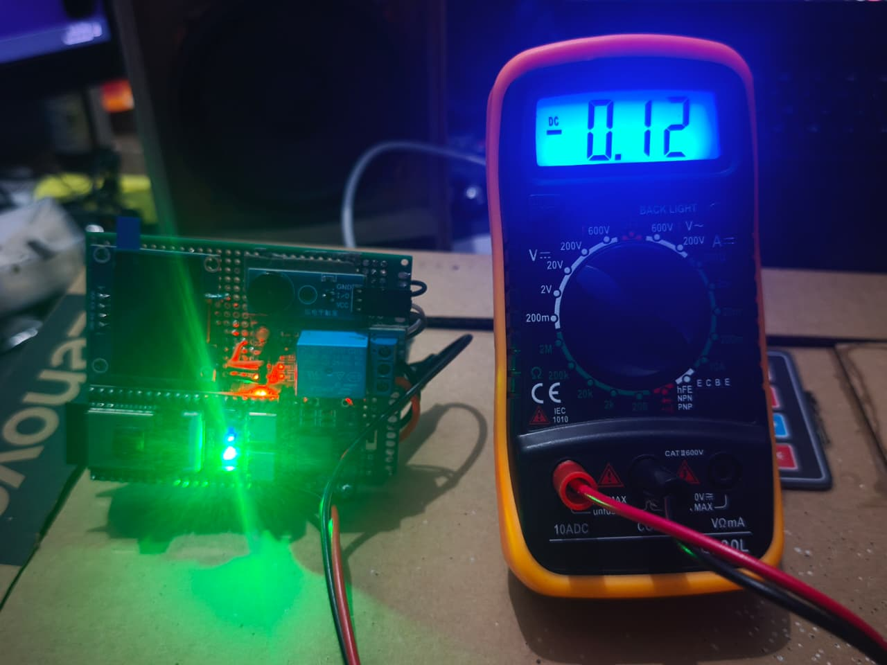
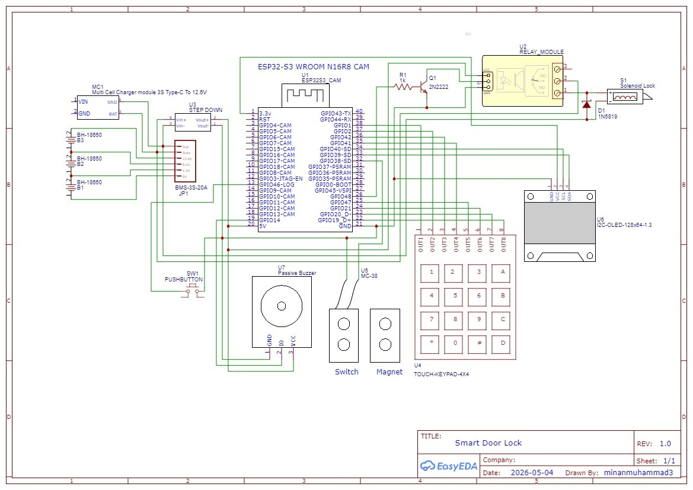
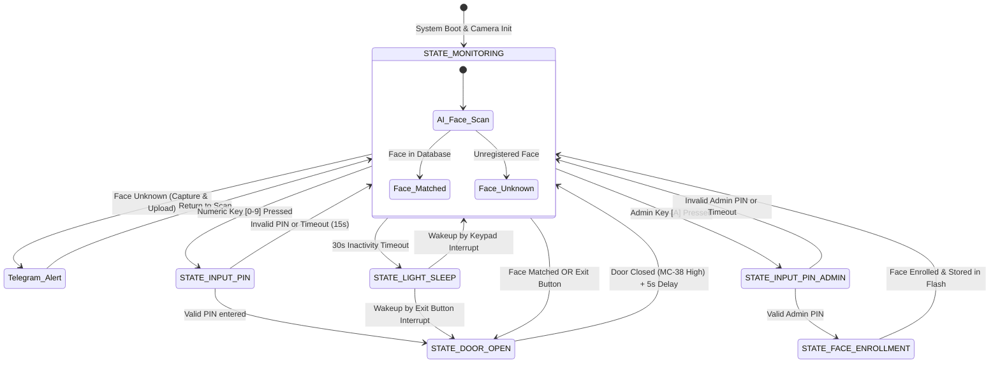

# 🚪 Smart Door Lock with Edge AI Face Recognition & Telegram Telemetry

<p align="center">
  
</p>

<p align="center">
  
  
  
  
  
  
</p>

---

## 📌 Overview

**Smart Door Lock** is an enterprise-grade, edge-computed IoT physical security system powered by the **ESP32-S3 (16MB Flash, 8MB Octal PSRAM)** and an **OV3660** image sensor. 

Unlike traditional IoT locks that depend on cloud computer-vision APIs—which introduce latency, recurring bandwidth costs, and privacy vulnerabilities—this system executes **on-device facial detection and recognition** directly at the network edge using Espressif's optimized neural network libraries (`ESP-WHO`). 

When an unrecognized face is detected attempting access, the system instantly switches resolution, captures a high-resolution snapshot, and streams it asynchronously to a designated **Telegram** account with real-time intruder warning alerts.

### 🌟 Key Highlights & Features
- **On-Device Edge AI Facial Recognition:**
  - Multi-stage neural network pipeline using MSR01 face detector, MNP01 keypoint aligner, and 112-dimensional feature embedding recognizer.
  - Zero cloud dependency for biometric authentication; facial embeddings are stored securely on non-volatile SPI flash (`fr` partition).
- **Instant Telegram Security Telemetry:**
  - Automated high-definition intruder snapshot streaming (`sendPhoto` via TLS `WiFiClientSecure` using memory-efficient 1024-byte chunking).
- **Multi-Factor / Fallback Access:**
  - 4x4 matrix keypad supporting alternative numeric PIN entry.
  - Dedicated Admin PIN mode allowing dynamic registration (enrollment) of new authorized faces directly on the device.
- **Intelligent Door State Management (Anti-Collision):**
  - Magnetic door sensor (**MC-38**) monitors physical latch alignment. The 12V solenoid deadbolt will never trigger while the door is ajar, preventing bolt strike damage.
- **Ultra Low-Power Light Sleep Architecture:**
  - Automatically suspends Wi-Fi, camera ISP, and CPU cores to light sleep after 30 seconds of inactivity (reducing current consumption from ~310mA to ~23mA).
  - Wakes up instantaneously (<50ms) upon Keypad keypress or Exit button actuation via GPIO level interrupts.
- **Local MJPEG Video Streaming:**
  - Integrated HTTP streaming server allowing live video feed inspection via local web browser.

---

## 📸 System Showcase & Visual Evidence

### 1. Physical Hardware & Mechanical Prototype
| Assembled Hardware Prototype | Physical Door Prototype Installation |
| :---: | :---: |
|  |  |
| *ESP32-S3, OV3660, 4x4 Keypad, 1.3" OLED, Relay & Solenoid* | *Mounted MC-38 Reed Switch & Interior Push Button* |

### 2. High-Contrast OLED Interface (SH1106G)
| Face Recognized (Access Granted) | Unknown Face (Access Denied) | Privacy Keypad PIN Entry |
| :---: | :---: | :---: |
|  |  |  |
| *Welcome screen & solenoid unlock* | *Denial alert & buzzer warning* | *Masked PIN input with instant feedback* |

### 3. Telegram Intruder Telemetry & Power Profiling
| Real-time Telegram Intruder Notification | Active Monitoring Power Draw | Low-Power Light Sleep Power Draw |
| :---: | :---: | :---: |
|  |  |  |
| *Automated capture & photo delivery* | *Active AI processing: ~310 mA* | *Power-saving standby: ~23 mA* |

---

## 🧩 Hardware Components (Bill of Materials)

| Component | Specification | Function |
| :--- | :--- | :--- |
| **ESP32-S3 WROOM N16R8 CAM** | Dual-core Xtensa LX7 @ 240MHz, 16MB Flash, 8MB OPI PSRAM | Central processing unit, neural network inference, Wi-Fi connectivity |
| **OV3660 Sensor Module** | 3.0 Megapixel CMOS, DVP interface, wide-angle lens | Image acquisition for facial analysis and security snapshots |
| **1.3" Monochrome OLED** | 128x64 resolution, SH1106G driver, I2C interface | Visual feedback, system status, and keypad input masking |
| **4x4 Matrix Keypad** | 16-key membrane keypad (0-9, A-D, *, #) | Backup passcode entry and administrator configuration |
| **MC-38 Magnetic Switch** | Normally Closed (NC) reed sensor | Door open/closed state sensing for anti-collision logic |
| **12V DC Solenoid Lock** | Fail-secure electromagnetic lock | Physical door locking mechanism |
| **1-Channel Relay Module** | 5V coil, 10A 250VAC contacts with 2N2222 transistor driver | High-current actuation control for 12V solenoid |
| **Active Buzzer** | 5V continuous audio indicator | Acoustic feedback for keypresses, access granted, and alarms |
| **Exit Push Button** | Momentary tactile switch (Internal) | Immediate one-touch unlocking from inside the room |
| **Power Supply / Buck Converter** | 12V 2A DC Adapter + LM2596 Step-down to 5V | Powers the 12V solenoid and 5V ESP32 electronics |

---

## ⚡ Circuit Schematic & Wiring Guide

<p align="center">
  
</p>

### 📌 Pin Mapping (ESP32-S3 WROOM N16R8)

```
+---------------------+----------------+-----------------------+
| Peripheral Device   | Device Pin     | ESP32-S3 GPIO Pin     |
+---------------------+----------------+-----------------------+
| 1.3" OLED (I2C)     | SDA            | GPIO 39               |
|                     | SCL            | GPIO 40               |
|                     | VCC / GND      | 3.3V / GND            |
+---------------------+----------------+-----------------------+
| Solenoid Actuator   | Relay Control  | GPIO 48 (via 2N2222)  |
| Audio Buzzer        | Signal (+)     | GPIO 14               |
| Magnetic Sensor     | MC-38 Sense    | GPIO 38 (Input Pullup)|
| Interior Push Button| Exit Button    | GPIO 46 (Input Pullup)|
+---------------------+----------------+-----------------------+
| Keypad 4x4 (Rows)   | Row 1, 2, 3, 4 | GPIO 1, 2, 42, 41     |
| Keypad 4x4 (Cols)   | Col 1, 2, 3, 4 | GPIO 47, 21, 20, 19   |
+---------------------+----------------+-----------------------+
| OV3660 Camera       | D0 – D7        | GPIO 11, 9, 8, 10,    |
|                     |                |      12, 18, 17, 16   |
|                     | XCLK / PCLK    | GPIO 15 / GPIO 13     |
|                     | VSYNC / HREF   | GPIO 6 / GPIO 7       |
|                     | SCCB SDA / SCL | GPIO 4 / GPIO 5       |
+---------------------+----------------+-----------------------+
```

---

## 🧠 System Architecture & Finite State Machine (FSM)

The system is engineered as an event-driven Finite State Machine (FSM) guaranteeing high responsiveness and deterministic transition between operational states:



---

## 💾 Flash Partition Table (`partitions.csv`)

Because on-device facial recognition models and firmware require substantial space, a custom partition table is configured for the 16MB Flash memory:

```csv
# Name,   Type, SubType, Offset,   Size,     Flags
nvs,      data, nvs,     0x9000,   0x5000,
otadata,  data, ota,     0xe000,   0x2000,
app0,     app,  ota_0,   0x10000,  0x500000,
fr,       data, spiffs,  0x510000, 0x200000,
spiffs,   data, spiffs,  0x710000, 0x100000,
```

- **`app0` (5 MB):** Accommodates the heavy binary containing the camera driver, TLS stack, and embedded neural network models.
- **`fr` (2 MB):** Dedicated storage partition for facial vector embeddings (`recognizer.set_partition`).
- **`spiffs` (1 MB):** File storage for auxiliary web interface and configurations.

---

## 🛠️ Setup & Flashing Instructions

### 1. Arduino IDE Setup
1. Install **[Arduino IDE 2.x](https://www.arduino.cc/en/software)**.
2. In **Preferences**, add the ESP32 board index URL:
   ```text
   https://raw.githubusercontent.com/espressif/arduino-esp32/gh-pages/package_esp32_index.json
   ```
3. Install **esp32 by Espressif Systems** (version 2.0.14 or later) via Boards Manager.

### 2. Required Libraries
Install the following libraries via Arduino Library Manager (`Ctrl + Shift + I`):
- `Keypad` (by Mark Stanley, Alexander Brevig)
- `Adafruit GFX Library` (by Adafruit)
- `Adafruit SH110X` (by Adafruit)
- `esp32-camera` (included with ESP32 board package)
- `ESP-WHO` neural network headers (`human_face_detect_msr01.hpp`, `human_face_detect_mnp01.hpp`, `face_recognition_112_v1_s8.hpp`)

### 3. Board Configuration Settings
Under the **Tools** menu in Arduino IDE, select the following parameters:
- **Board**: `ESP32S3 Dev Module`
- **Flash Size**: `16MB (128Mb)`
- **Partition Scheme**: `Custom` *(Place `partitions.csv` in the sketch folder)*
- **PSRAM**: `OPI PSRAM` *(Required for image buffers & neural network tensors)*
- **Upload Speed**: `921600`
- **USB CDC On Boot**: `Enabled`
- **Port**: Select the COM port connected to the ESP32-S3.

### 4. Configuration Parameters
Open `smart_door_lock.ino` and update your Wi-Fi and Telegram Bot credentials:
```cpp
#define WIFI_SSID "YOUR_WIFI_SSID"
#define WIFI_PASS "YOUR_WIFI_PASSWORD"
#define BOT_TOKEN "YOUR_TELEGRAM_BOT_TOKEN"
#define CHAT_ID   "YOUR_TELEGRAM_CHAT_ID"

#define PIN_ALTERNATIF "1234"  // Default backup user PIN
#define PIN_ADMIN      "9999"  // Admin PIN to enroll new faces
```

5. Click **Upload** (`Ctrl + U`).

---

## 🚀 How to Operate

1. **Facial Authentication:** Stand in front of the OV3660 camera. If your face is recognized, the OLED displays *"TERBUKA - WAJAH DIKENAL"*, the relay energizes the solenoid, and the door unlocks.
2. **Intruder Alert:** If an unknown person looks at the camera, access is rejected (*"DITOLAK - TIDAK DIKENAL"*), an acoustic buzzer alarm sounds, and an instant photo is dispatched to your Telegram Bot.
3. **PIN Authentication:** Press any number key on the keypad to activate PIN mode, enter the passcode, and press `*` to confirm (or `#` to cancel).
4. **Registering a New Face (Admin Mode):**
   - Press `A` on the keypad.
   - Enter the Admin PIN (`9999`) and press `*`.
   - Stand directly in front of the camera while the OLED shows *"Admin Mode - Scan Wajah.."*.
   - Upon successful enrollment, a confirmation tone sounds and the face is permanently memorized into flash storage.
5. **Interior Exit:** Press the exit button on the inside wall to unlock the door instantly.
6. **Live Camera Preview:** Connect to the same local Wi-Fi and enter `http://<ESP32_IP>/` in your browser to view the real-time MJPEG camera stream.

---

## 👥 Contributors

- **Hayqal Husein Alhabsyi**
- **Rizky Mardhani**
- **Mochammad Salman Al Farizy**
- **Muhammad Minanur Rohman**

---

## 📄 License

This project is licensed under the [MIT License](LICENSE) - free to use, modify, and distribute for personal and educational applications.
